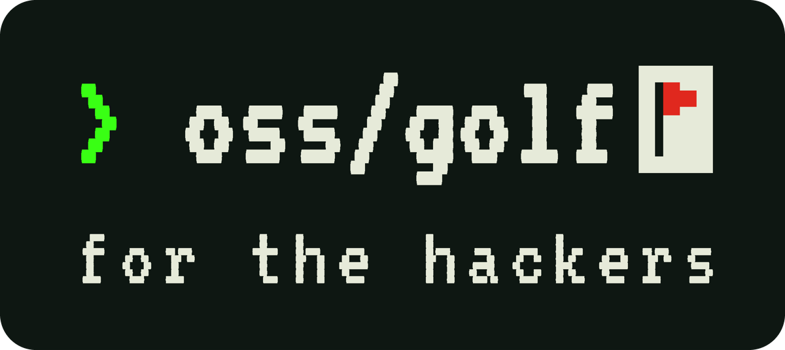
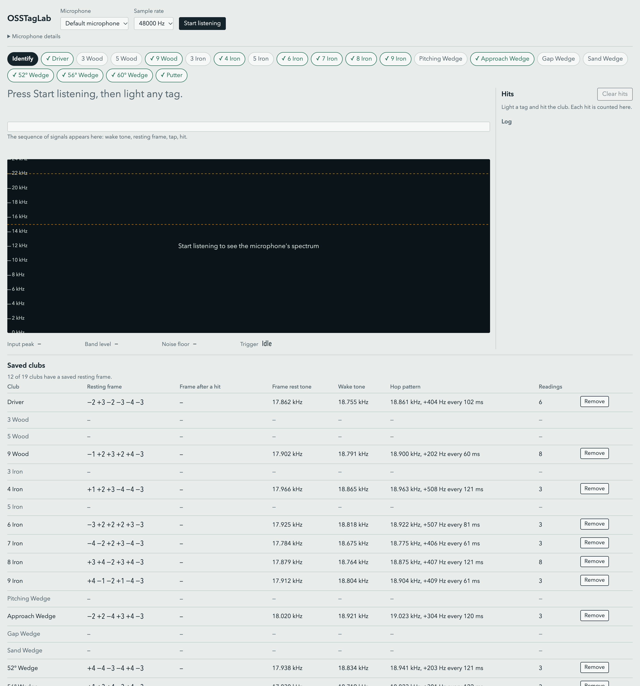
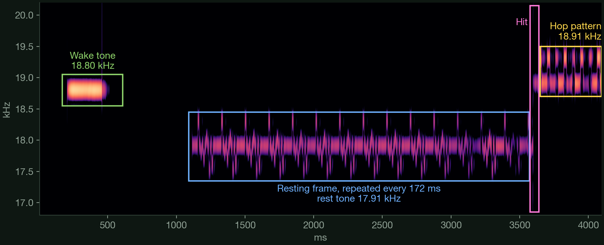
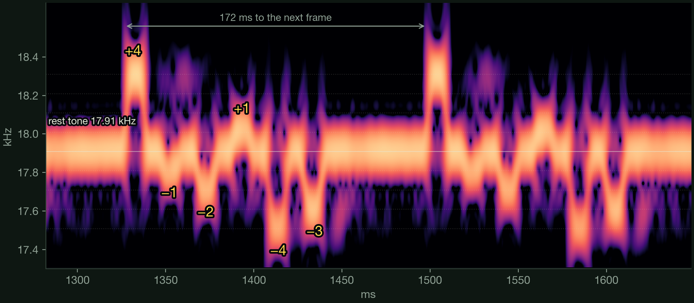
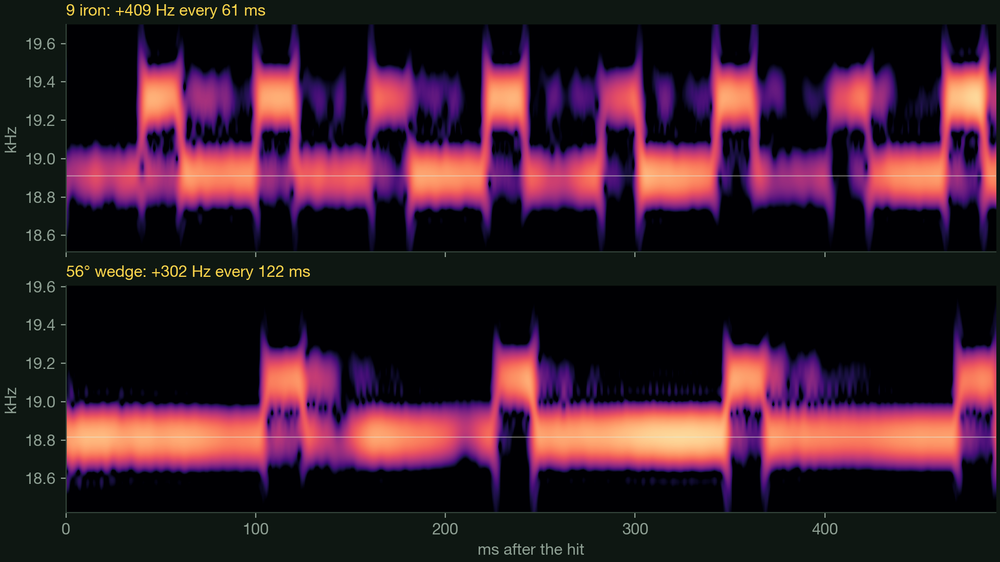
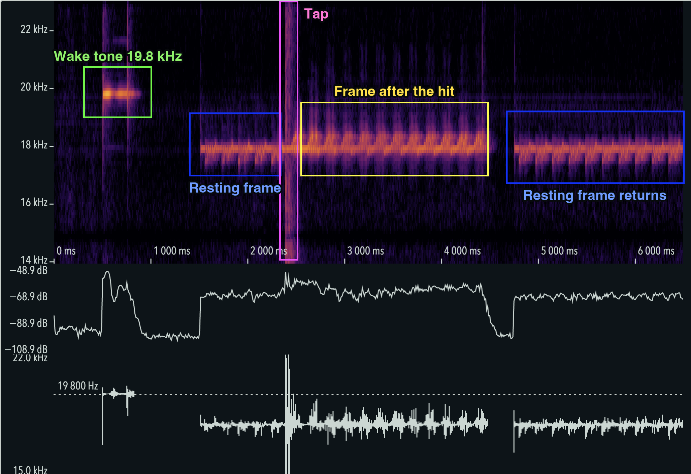

<p align="center">
  <a href="https://ossgolf.com"></a>
</p>

# OSSTagLab

A web app that listens to golf club tags, decodes the high frequency tones they send, and names the club.

Part of [OSSGolf](https://ossgolf.com), open source golf projects. The findings are on the blog: [OSSTagLab: decoding the sound of golf club tags](https://ossgolf.com/posts/osstaglab/).

<p align="center">
  
</p>

## What it does

- **Live spectrogram.** See the tag band, 17 to 20 kHz, as you shine a light on a tag.
- **Decoder.** Reads the three signals a tag sends: its wake tone, its resting frame, and its after hit signal.
- **Club mapping.** Pick a club, light its tag, tap the club, and the app saves what it sent.
- **Identify.** Light any mapped tag. The app names the club and counts each hit.
- **Captures.** Save a few seconds of audio and study it: spectrogram, level and frequency on one time axis.
- **Tools.** Command line scripts that decode and measure WAV files.

## Run it

You need Python 3.9 or newer and a browser. The server uses the standard library only.

```
git clone https://github.com/OSSGolf/osstaglab
cd osstaglab
python3 server.py
```

Open http://127.0.0.1:8765 and press **Start listening**. Use `--port` to pick another port.

The server listens on 127.0.0.1, so only your own computer can reach it.

### Microphone

- A laptop microphone works. We used the one built into a MacBook Pro.
- Record at 48 kHz, the default. 44.1 kHz and 96 kHz also work.
- The app asks the browser to turn off echo cancellation, noise suppression, automatic gain and voice isolation. **Microphone details** shows what the browser applied.
- On macOS, set Mic Mode to Standard in the menu bar while listening.

## Use it

The chip bar has **Identify** and one chip per club. A mapped club shows a check mark.

### Map a club

1. Press the club's chip.
2. Shine a light on its tag and hold for 3 seconds. A flashlight works.
3. The app reads the wake tone and the resting frame.
4. Tap the club head. The tag answers with its after hit signal.
5. Take the light away. When the tag goes quiet the app saves the club.

### Identify

Press **Identify** and light any tag. The app shows the club and counts a hit each time the tag answers one. The **Hits** panel keeps a total per club and a log.

### Captures

**Capture last 3 seconds** (or the Space key) saves the most recent audio. The trigger also captures by itself when the band from 15 to 22 kHz gets loud. Select a capture to open the analysis view, play it slowed down, or download it as a WAV.

## Where your data goes

Everything stays on your computer, in this folder. Git ignores all three.

| File | What it holds |
|---|---|
| `codebook.json` | The clubs you mapped. Until your first save the app shows `codebook.example.json`, the 12 clubs mapped on our set |
| `recordings/` | Captures, one WAV and one JSON file each |
| `identifications.jsonl` | One line per tag the app identified |

## How a tag talks

A tag sends one tone at a time. Each tag has its own rest tone near 18 kHz, and every signal is a step away from that tone and back.

<p align="center">
  
</p>

| Signal | When | What it is |
|---|---|---|
| Wake tone | The tag wakes, when light reaches it | One steady tone for about 0.4 s, about 0.9 kHz above the rest tone |
| Resting frame | While the tag is awake | Six symbols, repeated every 172 ms. Each symbol is a 10 ms tone 1 to 4 steps of 100 Hz above or below the rest tone |
| After hit signal (hop pattern) | After a hit | The rest tone moves up 1 kHz. A jump of 200 to 500 Hz, about 21 ms long, repeats every 60 to 120 ms for several seconds |

The resting frame names the club. The hop pattern confirms the hit.

<p align="center">
  
</p>

<p align="center">
  
</p>

The putter has two differences. Its wake tone is 19.81 kHz, 1.9 kHz above its rest tone. After a hit it stays on its rest tone and sends a second frame for about two seconds.

<p align="center">
  
</p>

## The decoder

`web/tag-decoder.js` turns audio into events. It takes audio samples and returns events, so the same file runs in the browser, in Node and in the tests.

1. **Track the tone.** A 10 ms Hann window, zero padded to 2,048 points, one FFT every millisecond, with a curve fitted through the peak. The strongest frequency between 16.5 and 21 kHz is kept when it stands 15 dB above the noise from 15 to 22 kHz.
2. **Classify.** The frequency track is split into wake tones, frames and hop patterns by how it steps away from the rest tone.
3. **Hear the hit.** A tap or strike is a short click across every frequency. The decoder listens for it from 2 to 8 kHz. Each answer from the tag is a hit, and the click gives its time.

`web/session.js` and `web/reading.js` turn events into clubs and hits. `web/tag-synth.js` makes synthetic tag audio for the tests.

## Tools

Run with `node tools/<name>.mjs`. They need Node 22 or newer.

| Script | What it does |
|---|---|
| `decode` | Prints the decoded event timeline of one or more WAV files |
| `spectro` | Renders a spectrogram of a WAV to a PNG |
| `analyze` | Band levels, envelope timeline and tone estimates for one WAV |
| `track` | Prints the strongest tone in a band every 10 ms |
| `symbols` | Lists each step away from the rest tone: start, length, offset |
| `frames` | Groups those steps into frames on a 100 Hz grid |
| `events` | Shows when the impact band and the tag bands are active |
| `tf` | Prints a time by frequency table of levels |
| `demod` | Mixes a carrier to baseband and prints amplitude and phase |
| `clip` | Cuts a time range out of a WAV |
| `tones` | Finds narrow tones in every WAV in a folder |
| `survey` | Summarizes every capture in a folder |
| `similarity` | Compares the bursts of every capture in a folder |

```
node tools/decode.mjs test/fixtures/iron9-wake-tap-hop.wav
```

```
     0.20-   0.58 s  Single tone 18.804 kHz for 375 ms
     1.11-   3.60 s  Data frames +4 −1 −2 +1 −4 −3, rest 17.909 kHz, 14 of 14 frames agree
     3.59-   3.63 s  Tap or strike, 34 dB above the room
     3.60-   4.10 s  Hop pattern, rest 18.909 kHz, jumps +409 Hz every 61.0 ms, 8 jumps
```

## Tests

```
node --test test/*.test.mjs
python3 -m unittest discover -s test -p 'test_*.py'
```

`test/fixtures` holds 15 short recordings: a 9 iron, a 56° wedge, a putter and the empty room. They are covered by the same license as the code.

## Layout

```
server.py              the local server: static files, captures, codebook
codebook.example.json  the 12 clubs mapped on our set
web/                   the app: plain ES modules, served as they are
tools/                 command line scripts
test/                  tests and recordings
```

## Notes

OSSTagLab is an independent project by OSSGolf, built by listening to our own set of tags. The codes in `codebook.example.json` were measured on that one set. Map your own set to get its codes.

Issues and pull requests are welcome.

## License

[MIT](LICENSE)
